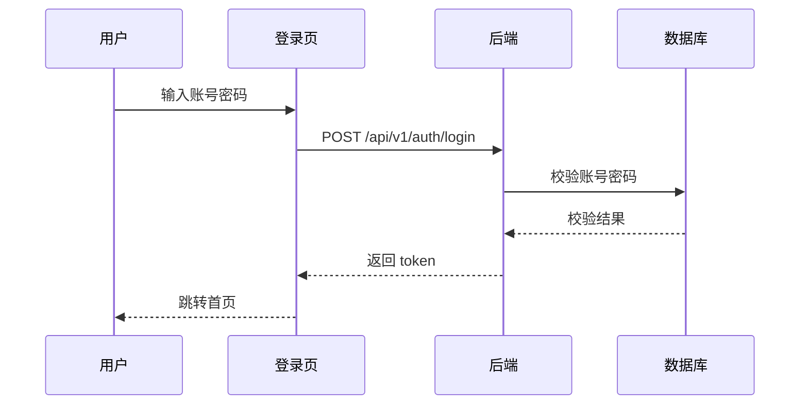

# 文档模板与字段规范

## 1. 需求文档模板

> ⚠️ **注意**：以下模板中的章节 **不是全部必填**。只保留 PRD 文档中实际包含的内容。
> - **业务逻辑（业务流程 + 业务规则）是核心**：必须优先确保完整准确。PRD 中含糊的地方要追问清楚
> - **没有的内容不要编写，也不要编造**（如 PRD 没提输入/输出规格，就不写该章节）
> - **信息不完整的章节**：只写 PRD 中明确提到的内容，其余留空
> - **Section 5（输入/输出规格）**：仅当 PRD 文档中有明确的字段定义、参数表格时再填写

```markdown
---
id: REQ-001
title: 用户登录功能
module: user-auth
version: 2.1
status: approved           # draft | approved | deprecated
priority: P0               # P0(核心) | P1(重要) | P2(一般) | P3(优化)
created: 2026-01-15
updated: 2026-06-01
author: 张三
reviewer: 李四
source: 用户认证PRD_v1.2.docx  # PRD导入时：指向 _source/ 中的原始文件名
source_page: 3-8              # 可选：源文件中的页码范围
tags: [登录, 认证, 安全, 验证码]
related_apis: [API-auth_login, API-auth_refresh]
related_bugs: [BUG-001]
test_case_ref: [TC-AUTH-001, TC-AUTH-002]
---

# 用户登录功能

## 1. 业务概述

[一句话描述功能的业务价值]

## 2. 前置条件

- [用户已注册账号]
- [账号状态正常（未锁定/未冻结）]

## 3. 业务流程

### 3.1 正常登录流程



### 3.2 流程图说明

1. 用户输入账号、密码
2. 系统校验账号是否存在
3. 系统校验密码是否正确
4. 校验通过后生成 token 并返回
5. 客户端存储 token，跳转首页

## 4. 业务规则

| 规则编号 | 规则描述 | 优先级 |
|---------|---------|--------|
| RULE-001 | 密码连续输错5次，账号锁定30分钟 | P0 |
| RULE-002 | Token 有效期24小时，刷新后延长 | P0 |
| RULE-003 | 登录失败次数每天0点重置 | P1 |
| RULE-004 | 同一账号不能同时在3个以上设备登录 | P2 |

## 5. 输入/输出规格  <!-- 可选章节：仅当 PRD 中有明确的字段定义、参数表格时填写 -->

### 输入

| 字段 | 类型 | 必填 | 约束 | 说明 |
|------|------|------|------|------|
| username | string | 是 | 6-50位，字母或数字 | 用户名 |
| password | string | 是 | 8-32位，含大小写+数字 | 密码 |
| captcha | string | 是 | 4位数字 | 图形验证码 |

### 输出（成功）

| 字段 | 类型 | 说明 |
|------|------|------|
| token | string | JWT token |
| expires_in | int | 过期时间（秒） |
| user_info | object | 用户基本信息 |

## 6. 验收标准

- [x] 正确账号密码能登录成功
- [x] 错误密码提示错误，并累计失败次数
- [x] 连续5次失败后锁定账号30分钟
- [x] 锁定期间正确密码也不能登录
- [x] 过期token访问返回401
- [x] 刷新token能获取新的有效token

## 7. 变更历史

| 版本 | 日期 | 变更人 | 变更内容 |
|------|------|--------|---------|
| v1.0 | 2026-01-15 | 张三 | 初始创建 |
| v2.0 | 2026-05-10 | 张三 | 增加RULE-004多设备限制 |
| v2.1 | 2026-06-01 | 李四 | 明确验证码类型为图形验证码 |

## 8. 关联文档

- **接口文档**：[API-auth_login](./API-auth_login.md)、[API-auth_refresh](./API-auth_refresh.md)
- **缺陷记录**：[BUG-001](./BUG-001_登录会话超时未跳转.md)
- **术语说明**：参见 `_glossary.md` 中 "JWT Token" 定义
```

### 必填字段说明

| frontmatter 字段 | 说明 |
|-----------------|------|
| `id` | 全局唯一标识，生成后不可修改 |
| `title` | 简洁的功能标题（不超过20字） |
| `module` | 所属模块，与目录名一致 |
| `version` | 版本号，主版本.次版本 |
| `status` | 文档状态 |
| `priority` | 优先级，P0 最高 |
| `created` | 创建日期 |
| `tags` | 标签，便于检索和分类 |
| `related_apis` | 关联接口 ID 列表 |

---

## 2. 接口文档模板

```markdown
---
id: API-auth_login
title: 用户登录接口
module: user-auth
version: 2.0
method: POST
path: /api/v1/auth/login
content_type: application/json
auth_required: false
rate_limit: 10次/分钟/IP
source: openapi_v3.json       # 接口导入时：指向 _source/ 中的原始文件名
source_type: openapi3         # swagger | openapi3 | postman | manual
related_requirements: [REQ-001]
related_bugs: [BUG-001]
tags: [登录, 认证]
---

# 用户登录接口

## 1. 接口描述

[一句话描述接口功能]

## 2. 请求说明

### 请求地址

`POST /api/v1/auth/login`

### 请求头

| 参数名 | 必填 | 说明 |
|--------|------|------|
| Content-Type | 是 | application/json |
| X-Request-Id | 否 | 幂等键，推荐传入 |

### 请求体

```json
{
  "username": "zhangsan",
  "password": "Abc12345",
  "captcha": "1234"
}
```

### 请求参数字段

| 字段 | 类型 | 必填 | 约束 | 示例 | 说明 |
|------|------|------|------|------|------|
| username | string | 是 | 6-50位字母数字 | "zhangsan" | 用户名 |
| password | string | 是 | 8-32位，含大小写+数字 | "Abc12345" | 密码 |
| captcha | string | 是 | 4位数字 | "1234" | 图形验证码 |

## 3. 响应说明

### 成功响应

**HTTP 状态码**: `200 OK`

```json
{
  "code": 0,
  "message": "success",
  "data": {
    "token": "eyJhbGciOiJIUzI1NiIs...",
    "expires_in": 86400,
    "user_info": {
      "user_id": 1001,
      "username": "zhangsan",
      "nickname": "张三",
      "avatar": "https://...",
      "role": "user"
    }
  }
}
```

### 响应字段说明

| 字段 | 类型 | 说明 |
|------|------|------|
| code | int | 业务状态码，0=成功 |
| message | string | 提示信息 |
| data.token | string | JWT token |
| data.expires_in | int | 过期时间（秒），默认86400 |
| data.user_info | object | 用户基本信息 |

### 错误响应

**HTTP 状态码**: `400 Bad Request`

```json
{
  "code": 1001,
  "message": "用户名或密码错误",
  "data": null
}
```

### 业务错误码表

| code | message | 触发条件 | HTTP 状态码 |
|------|---------|---------|-------------|
| 0 | success | 成功 | 200 |
| 1001 | 用户名或密码错误 | 账号或密码不匹配 | 400 |
| 1002 | 账号已被锁定 | 连续5次输错密码 | 403 |
| 1003 | 验证码错误 | 验证码不匹配 | 400 |
| 1004 | 账号不存在 | 用户名未注册 | 400 |
| 1005 | 设备数超限 | 超过3个设备同时登录 | 403 |
| 9999 | 系统内部错误 | 服务器异常 | 500 |

## 4. 业务逻辑说明

- 密码使用 bcrypt 加密存储和比对
- 连续输错5次后账号锁定30分钟
- 登录成功后返回 JWT token，通过 `API-auth_refresh` 刷新
- 每次登录记录 IP、设备信息、登录时间到日志

## 5. 变更历史

| 版本 | 日期 | 变更人 | 变更内容 |
|------|------|--------|---------|
| v1.0 | 2026-01-10 | 王五 | 初始创建 |
| v2.0 | 2026-05-10 | 王五 | 增加设备数限制校验 (1005) |
```

### 必填字段说明

| frontmatter 字段 | 说明 |
|-----------------|------|
| `method` + `path` | HTTP 方法和路径 |
| `content_type` | 请求体类型 |
| `auth_required` | 是否需要认证 |
| `rate_limit` | 限流策略 |
| `source` | 原始源文件名（导入时自动填写） |
| `source_type` | 源文件类型：manual/swagger/openapi3/postman |
| `related_requirements` | 关联需求 ID |

---

## 3. 缺陷记录模板

```markdown
---
id: BUG-001
title: 登录会话超时后未正确跳转
module: user-auth
severity: major              # critical | major | minor | trivial
status: closed               # open | in_progress | fixed | verified | closed | reopened
created: 2026-03-10
updated: 2026-03-15
closed_date: 2026-03-15
found_by: 赵六
assigned_to: 王五
found_in_version: 1.2.0
fixed_in_version: 1.2.1
root_cause: 前端未检测 token 过期状态码
related_requirements: [REQ-001]
related_apis: [API-auth_login]
tags: [会话, 前端, token过期]
environment: 
  os: iOS 16.0
  browser: Safari 16.0
  app_version: 1.2.0
---

# BUG-001: 登录会话超时后未正确跳转

## 缺陷描述

token 过期后，用户在页面操作时没有自动跳转到登录页，而是显示白屏或接口调用失败的错误提示。

## 复现步骤

1. 用户登录系统
2. 等待 Token 过期（24小时），或手动清除本地 token
3. 在任意页面点击按钮触发接口请求
4. 观察页面响应

## 预期结果

检测到 token 过期（接口返回 401），自动跳转到登录页，并提示"登录已过期，请重新登录"

## 实际结果

页面显示接口调用的错误信息（如 "Network Error" 或无响应），未跳转到登录页

## 影响范围

- 所有需要登录的页面
- 用户在 token 过期后继续操作时会遇到白屏或错误提示

## 根本原因分析

前端 axios 拦截器未正确处理 `code: 1001`（Token过期）的情况，只处理了 HTTP 401，但后端在 token 过期时返回的是 200 + 业务错误码 1001

## 修复方案

前端 axios 响应拦截器中增加业务状态码 `1001` 的处理：

```javascript
axios.interceptors.response.use(
  response => {
    if (response.data.code === 1001) {
      // Token过期，清除本地token，跳转登录页
      localStorage.removeItem('token');
      window.location.href = '/login';
      return Promise.reject(new Error('登录已过期'));
    }
    return response;
  },
  error => {
    // 处理 HTTP 级别的错误
    return Promise.reject(error);
  }
);
```

## 验证方法

1. 清除本地存储的 token
2. 在已登录页面执行操作
3. 验证是否自动跳转到登录页，并显示"登录已过期，请重新登录"的提示
4. 验证正常登录后业务恢复正常

## 关联用例

- 功能测试：TC-AUTH-005 Token过期自动跳转
- 接口测试：应在接口自动化中添加业务状态码 1001 的校验
- UI 测试：应覆盖 token 过期后的页面跳转场景
```

### 必填字段说明

| frontmatter 字段 | 说明 |
|-----------------|------|
| `severity` | 严重程度，会影响测试优先级 |
| `root_cause` | 根本原因分类，用于分析缺陷模式 |
| `found_in_version` | 发现版本，便于追溯 |
| `related_requirements` | 关联需求，必须填写 |
| `environment` | 环境信息，便于复现 |
| `tags` | 必须包含功能标签，便于统计分析 |

---

## 4. 模块概述模板 (`_overview.md`)

```markdown
# 用户认证模块

## 模块职责
负责用户的身份认证、权限管理，是系统的基础模块。

## 核心功能
- 用户登录（账密 + 验证码）
- 用户注册（含邮箱/手机验证）
- Token 颁发与刷新
- 权限校验

## 业务流程图
[系统架构图或业务流程图]

## 模块接口列表
| 接口 | 方法 | 路径 | 需求 |
|------|------|------|------|
| API-auth_login | POST | /api/v1/auth/login | REQ-001 |
| API-auth_register | POST | /api/v1/auth/register | REQ-002 |
| API-auth_refresh | POST | /api/v1/auth/refresh | REQ-001 |

## 模块缺陷统计
| 严重程度 | 数量 | 最多的 Root Cause |
|---------|------|-------------------|
| Critical | 1 | session 未同步 |
| Major | 3 | 前端状态检测缺失 |
| Minor | 2 | UI 文案问题 |

## 维护记录
| 日期 | 操作 | 说明 |
|------|------|------|
| 2026-06-01 | 新增 REQ-003 | 增加权限管理功能 |
```

---

## 5. 业务术语模板 (`_glossary.md`)

```markdown
# 业务术语表

## 术语定义

| 术语 | 英文/别名 | 定义 | 使用场景 |
|------|-----------|------|---------|
| Token | 访问令牌 | 用户登录后颁发的 JWT 令牌，用于接口鉴权 | 所有需要登录的接口 |
| 鉴权 | Authentication | 验证用户身份合法性的过程 | 登录、接口访问 |
| 授权 | Authorization | 判断用户是否有权限执行操作 | 权限控制功能 |

## 缩写说明

| 缩写 | 全称 | 说明 |
|------|------|------|
| JWT | JSON Web Token | 基于 JSON 的开放标准令牌格式 |
| OTP | One-Time Password | 一次性密码，用于验证码场景 |
```

---

## 6. 系统架构模板 (`_architecture.md`)

```markdown
# 系统架构说明

## 整体架构图

[架构图描述：前端 → Nginx → API Gateway → 微服务 → 数据库]

## 技术栈

- **前端**：React 18 + TypeScript + Vite
- **后端**：Java Spring Boot 3.x + MyBatis
- **数据库**：MySQL 8.0 + Redis 7.x
- **部署**：Docker + Kubernetes

## 模块依赖关系

- user-auth ← 无依赖（基础模块）
- payment → 依赖 user-auth
- order → 依赖 user-auth, payment

## 环境说明

| 环境 | 域名 | 数据库 |
|------|------|--------|
| 开发(dev) | dev.example.com | dev_db |
| 测试(test) | test.example.com | test_db |
| 预发布(staging) | staging.example.com | staging_db |
| 生产(prod) | www.example.com | prod_db |
```
